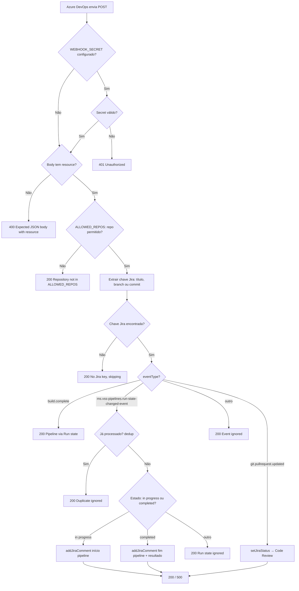

## webhook-function-version-2

Cópia de trabalho para **melhorias** após a apresentação. Código base vindo de `webhook-azure-function-version-1`. `local.settings.json` não foi copiado (use `local.settings.json.example`).

---

# Webhook Azure DevOps → Jira

Uma **Azure Function** que recebe eventos do Azure DevOps (Service Hooks) e atualiza o Jira Cloud automaticamente: transição de status em Pull Request e comentários em eventos de Pipeline.

## Visão Geral

O Webhook Azure DevOps → Jira integra **Azure DevOps** e **Jira Cloud** por meio de uma única HTTP-triggered Function. Quando um PR é atualizado ou uma pipeline muda de estado, a function extrai a chave do issue (título, branch ou commit), valida o repositório (opcional) e chama a API do Jira para **mudar status** ou **adicionar comentários**. **Arquitetura em camadas com TypeScript, serviços dedicados e tipos explícitos.**

- **📋 Pull Request** – Ao atualizar um PR, o issue no Jira é movido para o status configurado (ex.: "Code Review").
- **🔧 Pipeline (Run state changed)** – Comentários no Jira com início/fim da execução, resultado, link e data/hora em Brasília.
- **📁 Filtro por repositório** – Opcional: processar apenas repos listados em `ALLOWED_REPOS`.
- **🔄 Deduplicação** – Evita processar o mesmo evento duas vezes (retentativas do Azure).
- **🔐 Segredo opcional** – Validação por `WEBHOOK_SECRET` (header ou query).

### 🏗️ Arquitetura em Camadas

O projeto separa responsabilidades em camadas:

1. **Handlers** (`src/handlers/`) – Ponto de entrada HTTP e orquestração da requisição.
2. **Services** (`src/services/`) – Uma pasta por serviço: `jira/`, `pipeline-payload/`, `deduplication/`, `repository-filter/`, `azure-devops/` (cada uma com `index.ts` e testes).
3. **Types** (`src/types/`) – Tipos TypeScript para payload, request e context.
4. **Config** – `local.settings.json` (local) e Application settings (Azure); `function.json` em `src/webhook/`.

### 🚀 Funcionalidades Principais

- **🔗 Integração Azure DevOps + Jira** – Service Hooks → Function → Jira Cloud API.
- **📌 Extração de chave Jira** – Título do PR, nome da branch ou mensagem do commit (main).
- **⏱️ Data/hora em Brasília** – Comentários de pipeline com horário local.
- **🛡️ Validação de payload** – Body com `resource` obrigatório; resposta 400 quando inválido.
- **💯 TypeScript** – Código tipado, compilado para `dist/` em runtime.
- **📦 Deploy por zip ou func publish** – Publicação no Function App com variáveis no Portal.
- **📝 Logs de depuração** – O handler e os serviços (webhook, Jira, Azure DevOps) emitem logs em inglês (`[webhook]`, `[jira]`, `[azure-devops]`) para acompanhamento no Azure (Log stream ou Application Insights).

## Instalação

### 🚀 Configuração Rápida (local)

**Ideal para:** testar o webhook na sua máquina antes do deploy.

1. Clone o repositório e entre na pasta:
   ```bash
   git clone <url-do-repositorio>
   cd webhook-azure-function
   ```

2. Instale dependências e crie o arquivo de configuração:
   ```bash
   npm install
   cp local.settings.json.example local.settings.json
   ```

3. Edite `local.settings.json` com as variáveis do Jira (e opcionais). Veja [Variáveis de ambiente](#-variáveis-de-ambiente).

4. Para rodar localmente, você precisa de **dois terminais**:
   - **Terminal 1:** `npm run start:storage` (Azurite – deixe rodando).
   - **Terminal 2:** `npm run start` (build + host da Function).

5. Teste com `curl` em um terceiro terminal. Exemplo:
   ```bash
   curl -X POST http://localhost:7071/api/webhook \
     -H "Content-Type: application/json" \
     -d '{"eventType":"git.pullrequest.updated","resource":{"title":"[BEESEDI-11] Teste","repository":{"name":"meu-repo"},"sourceBranch":"refs/heads/feature/BEESEDI-11"}}'
   ```

### 🧪 Testes unitários (Jest)

O projeto usa **Jest** com **ts-jest** para testes dos services (sem chamar Jira nem Azure).

| Comando | Descrição |
|--------|------------|
| `npm test` | Roda todos os testes uma vez. |
| `npm run test:watch` | Roda testes em modo watch (re-executa ao salvar). |
| `npm run test:coverage` | Gera relatório de cobertura em `coverage/`. |

**O que é testado:**

- **handlers/webhook.handler** – Validação (401/400), filtro de repo, extração de chave, eventos (PR, pipeline, build.complete, duplicado, ignorado). Services mockados.
- **services/jira** – `formatBrasilia`, `extractJiraKey`, `extractJiraKeyFromPayload`.
- **services/pipeline-payload** – `getRunId`, `getRunUrl`, `getPipelineName`, `getBranch`.
- **services/deduplication** – `isDuplicate`, `markProcessed`.
- **services/repository-filter** – `getRepoName`, `isRepoAllowed` (com `ALLOWED_REPOS`).

### 📘 Deploy no Azure (detalhado)

**Ideal para:** publicar no Function App e usar em produção.

#### Ordem dos passos antes do deploy

Siga **nesta ordem** para evitar erro e garantir que o deploy use o código certo:

| # | Passo | Por quê |
|---|--------|--------|
| 1 | **Ter o Function App criado no Azure** (e conta de Storage com `AzureWebJobsStorage` configurado). | O deploy envia o código para um app já existente. |
| 2 | **Configurar Application settings** no Function App (Jira, PAT, WEBHOOK_SECRET, ALLOWED_REPOS, etc.). | As variáveis já ficam disponíveis assim que o código subir. |
| 3 | **Na pasta do projeto:** `npm install` (se ainda não rodou). | Garante que dependências estejam instaladas antes do build. |
| 4 | **Rodar `npm run build`.** | Gera a pasta `dist/` (JavaScript) e a pasta `webhook/` na raiz (com `function.json`). O host do Azure usa esses arquivos. |
| 5 | **Só então** fazer o deploy (por `func publish` ou por zip). | O zip ou o `func` devem conter o resultado do build (não o TypeScript em `src/`). |

Resumo em comando (até o passo 4):

```bash
cd webhook-azure-function
npm install
npm run build
# A partir daqui: deploy (ver abaixo)
```

#### Opção 1: Deploy com `func azure functionapp publish`

**Quando usar:** primeira tentativa; é o jeito mais rápido se funcionar.

```bash
npm run build
func azure functionapp publish <nome-app> --resource-group <resource-group>
```

Exemplo (nome do app e resource group reais):

```bash
func azure functionapp publish webhookazurojira --resource-group webhookJiraAzuro
```

**Se der erro** (ex.: *"Value cannot be null"* ou *"Can't find app"*), use a **Opção 2 – Deploy por zip** abaixo.

#### Opção 2: Deploy por zip (quando `func publish` não funciona)

O comando `func azure functionapp publish` às vezes falha (ex.: *"Value cannot be null. (Parameter 'input')"*). Nesse caso o deploy por zip é a forma **correta e estável**.

**O que precisa estar no zip:**

- `host.json` – configuração do host.
- `package.json` – dependências (o Azure pode rodar `npm install` se precisar).
- `webhook/` – pasta com `function.json` (gerada pelo `npm run build`).
- `dist/` – código compilado em JavaScript (gerado pelo `npm run build`).

**O que NÃO pode ir no zip:**

- `local.settings.json` – contém segredos; use só Application settings no Azure.
- `src/` – código TypeScript; o Azure usa só o que está em `dist/`.
- `.git/`, `node_modules/` (opcional excluir para zip menor; o Azure pode instalar dependências).
- Arquivos de desenvolvimento: `*.ts`, `tsconfig.json`, `.env`, etc.

**Passo a passo (na ordem):**

1. **Build** (obrigatório antes de zipar):

   ```bash
   cd webhook-azure-function
   npm run build
   ```

2. **Criar o zip** na raiz do projeto (inclui `dist/`, `webhook/`, `host.json`, `package.json`; exclui o que não deve subir):

   ```bash
   zip -r deploy.zip . \
     -x "*.git*" \
     -x "local.settings.json" \
     -x "deploy.zip" \
     -x "src/*" \
     -x "*.ts" \
     -x "tsconfig.json" \
     -x ".env*" \
     -x "*.md" \
     -x "node_modules/*"
   ```

   Se quiser incluir `node_modules` (evita `npm install` no Azure), **remova** a linha `-x "node_modules/*"` do comando acima.

3. **Publicar o zip** no Function App (substitua `<resource-group>` e `<nome-app>` pelos valores reais):

   ```bash
   az functionapp deployment source config-zip \
     --resource-group <resource-group> \
     --name <nome-app> \
     --src deploy.zip
   ```

   Exemplo:

   ```bash
   az functionapp deployment source config-zip \
     --resource-group webhookJiraAzuro \
     --name webhookazurojira \
     --src deploy.zip
   ```

4. Aguarde a conclusão (resposta **202 Accepted** significa que o deploy foi aceito; pode levar 1–2 minutos para o app reiniciar).

**Como conferir o nome do app e do resource group:**

```bash
az functionapp list --query "[].{name:name, resourceGroup:resourceGroup}" -o table
```

Use a coluna **name** como `<nome-app>` e **resourceGroup** como `<resource-group>`.

#### Depois do deploy

- No **Azure DevOps** → **Project settings** → **Service hooks** → **Create subscription** → **Web Hooks** → use como URL: `https://<seu-app>.azurewebsites.net/api/webhook` (ou a URL exata do seu app, ex.: `https://webhookazurojira-ede5cfahe6epeefc.brazilsouth-01.azurewebsites.net/api/webhook`).

#### Como saber se o deploy foi feito (e deu certo)

| Onde ver | O que significa |
|----------|-----------------|
| **Resposta do comando** | **Deploy por zip:** se aparecer *"Deployment endpoint responded with status code 202"* → o deploy foi **aceito** (o Azure processa em 1–2 min). **Deploy com func:** se terminar sem erro e mostrar a URL do app → o deploy foi enviado. |
| **Portal Azure** | Abra o Function App → **Overview**: status **Running** → **Functions**: deve listar a função **webhook** e a URL. **Deployment Center**: último deployment com status **Success**. |
| **Teste com curl** | Rode um POST na URL do webhook (ex.: `curl -X POST https://<seu-app>.azurewebsites.net/api/webhook -H "Content-Type: application/json" -d '{}'`). Se retornar **400** com `"error": "Expected JSON body with resource"` → a function está **no ar** e respondendo. Timeout ou conexão recusada → app ainda iniciando ou URL incorreta. |
| **Logs no Azure** | No Function App → **Monitor** → **Log stream** (ou **Application Insights** → **Logs**). Ao enviar um request, devem aparecer linhas como `[webhook] POST received`. Se aparecer, o deploy está ativo e a função está sendo executada. |

**Resumo:** considere o deploy concluído quando (1) o comando não falhou (e, no zip, retornou 202); (2) no Portal a função **webhook** aparece com URL; (3) o curl na URL retorna 400 com a mensagem de body inválido.

#### Logs de depuração e onde visualizar

A aplicação inclui **logs de depuração em inglês** no handler e nos serviços para facilitar o acompanhamento no Azure:

- **Handler** (`[webhook]`): validação do secret, payload, filtro de repositório, resolução da chave Jira, tipo de evento e resultado (ex.: `POST received`, `Secret validated successfully`, `Processing run-state-changed for`, `Status updated successfully for`).
- **Jira** (`[jira]`): chamadas de comentário e transição de status (ex.: `POST comment for`, `setJiraStatus`, `Transition not found`).
- **Azure DevOps** (`[azure-devops]`): busca da chave Jira no commit (ex.: `Key extracted from commit`, `GET commit failed`).

**Onde ver os logs:**

| Onde | Uso |
|------|-----|
| **Function App → Monitor → Log stream** | Acompanhar em tempo real; não precisa escrever consultas. |
| **Function App → Application Insights → Logs** | Consultas (KQL) para filtrar e buscar logs por período ou texto. |
| **CLI** | `az webapp log tail --resource-group <resource-group> --name <nome-app>` para stream no terminal. |

**Consultas no Application Insights (Logs):**

Abra **Application Insights** → **Logs**, use o editor de consultas e execute uma das consultas abaixo. Ajuste o **Intervalo de tempo** (ex.: últimas 24 horas) conforme necessário.

Ver os logs do webhook, Jira e Azure DevOps:

```kusto
traces
| where message contains "[webhook]" or message contains "[jira]" or message contains "[azure-devops]"
| order by timestamp desc
| take 100
```

Ver apenas erros ou avisos:

```kusto
traces
| where severityLevel >= 2 and (message contains "[webhook]" or message contains "[jira]")
| order by timestamp desc
| take 50
```

### 🌍 Compatibilidade

- ✅ **macOS** (testado)
- ✅ **Linux**
- ⚠️ **Windows** (via WSL ou Git Bash recomendado)

**Requisitos:**

- Node.js >= 18
- npm
- Azure Functions Core Tools v4
- Conta Azure e Jira Cloud (com API token)

### 📚 Template de Configuração

- **📁 [local.settings.json.example](./local.settings.json.example)** – Template para variáveis locais (copiar para `local.settings.json`; não commitar).

```bash
# Copiar e editar variáveis
cp local.settings.json.example local.settings.json
# Edite local.settings.json com JIRA_BASE_URL, JIRA_USER_EMAIL, JIRA_API_TOKEN, etc.
```

## Solução de Problemas

### Port 7071 is unavailable

Outro processo (ex.: outro `func start`) está usando a porta.

**Solução:** Descubra o processo com `lsof -i :7071` e encerre com `kill <PID>`. Ou inicie o host em outra porta: `func start --port 7072`.

### Host não inicia / não mostra "Host started"

O Azure Functions exige Storage. Localmente, o Azurite precisa estar rodando.

**Solução:** Em um terminal, rode `npm run start:storage` e deixe rodando. No `local.settings.json`, use `"AzureWebJobsStorage": "UseDevelopmentStorage=true"`. Em outro terminal, rode `npm run start`.

### Can't find app with name "..."

O nome usado no `func azure functionapp publish` está incorreto ou a subscription ativa não é a do Function App.

**Solução:** Liste os apps com `az functionapp list -o table` e use o valor da coluna **Name**. Se o app estiver em outra subscription, use `az account set -s <SubscriptionId>`.

### Value cannot be null (func publish)

Erro conhecido do `func publish` em alguns ambientes (ex.: *"Value cannot be null. (Parameter 'input')"*).

**Solução:** Use o **deploy por zip**: siga a [Opção 2: Deploy por zip](#opção-2-deploy-por-zip-quando-func-publish-não-funciona) na seção "Deploy no Azure". Ordem: `npm run build` → criar o zip (sem `src/`, sem `local.settings.json`) → `az functionapp deployment source config-zip ...`.

### Jira transition failed

Credenciais incorretas, issue inexistente ou nome do status diferente do fluxo do Jira.

**Solução:** Confira `JIRA_BASE_URL`, `JIRA_USER_EMAIL`, `JIRA_API_TOKEN`. Use uma chave de issue real. O valor de `JIRA_STATUS_CODE_REVIEW` deve ser **exatamente** o nome da transição no Jira (ex.: "Code Review"). Veja os logs do host para mensagens `[jira]`.

### 401 Unauthorized no webhook

`WEBHOOK_SECRET` está configurado e a requisição não envia o segredo.

**Solução:** Envie o header `x-webhook-secret` ou `?secret=...` com o mesmo valor configurado no Azure (e no Service Hook, se aplicável).

### Status no Jira não muda ao atualizar o PR

O webhook só muda o status quando o Azure DevOps envia o evento **Pull request updated** e a function encontra a chave Jira e consegue aplicar a transição no Jira. Se nada acontece, confira na ordem:

| # | O que verificar | Como |
|---|-----------------|------|
| 1 | **Service Hook configurado?** | Azure DevOps → **Project settings** → **Service hooks** → deve existir uma subscription com trigger **Pull request updated** (ou equivalente) e a URL do seu webhook. |
| 2 | **Chave Jira no PR?** | O **título** do PR ou o **nome da branch** precisa ter a chave (ex.: `[BEESEDI-11]` ou `feature/BEESEDI-11`). Sem isso a function responde 200 e "No Jira key, skipping". |
| 3 | **ALLOWED_REPOS** | Se no Azure estiver preenchido, o **nome do repositório** do PR precisa estar na lista (vírgula). Senão a function responde 200 e "Repository not in ALLOWED_REPOS". |
| 4 | **Application settings no Azure** | No Function App → **Configuration** → **Application settings**: `JIRA_BASE_URL`, `JIRA_USER_EMAIL`, `JIRA_API_TOKEN` corretos. `JIRA_STATUS_CODE_REVIEW` deve ser **exatamente** o nome da transição no fluxo do Jira (ex.: "Code Review"). |
| 5 | **Nome da transição no Jira** | No Jira, no fluxo do projeto, a transição para a qual você quer ir tem que ter o **mesmo nome** que `JIRA_STATUS_CODE_REVIEW` (incluindo maiúsculas/espaços). Se no Jira for "Em revisão", configure `JIRA_STATUS_CODE_REVIEW=Em revisão` no Azure. |
| 6 | **Logs da Function** | No Azure → Function App → **Monitor** → **Log stream** ou **Application Insights** → **Logs** (veja [Logs de depuração e onde visualizar](#logs-de-depuração-e-onde-visualizar)). Ao atualizar o PR, veja se aparece `[webhook] POST received` e o objeto com `eventType`, `title`, `sourceBranch`, `jiraKey`. Se aparecer `jiraKey: (not found)` ou "Repository not in ALLOWED_REPOS", o problema está antes do Jira. Se aparecer "[jira] Transition not found" ou "POST transition failed", ajuste o nome do status ou as credenciais. |

**Teste manual:** Envie um POST simulando o Azure DevOps (substitua a chave e o repo):

```bash
curl -X POST https://webhookazurojira-ede5cfahe6epeefc.brazilsouth-01.azurewebsites.net/api/webhook \
  -H "Content-Type: application/json" \
  -d '{"eventType":"git.pullrequest.updated","resource":{"title":"[BEESEDI-11] Teste PR","repository":{"name":"NOME_DO_SEU_REPO"},"sourceBranch":"refs/heads/feature/BEESEDI-11"}}'
```

Se esse `curl` mudar o status no Jira, o problema está no Service Hook (trigger, URL ou filtros). Se não mudar, confira as Application settings e o nome da transição no Jira.

## Configuração

Para lista completa de variáveis, valores obrigatórios/opcionais e onde configurar (local vs Azure), consulte a seção [Variáveis de ambiente](#-variáveis-de-ambiente) abaixo.

**No Azure:** todas as variáveis sensíveis devem estar em **Configuration** → **Application settings** do Function App; não inclua `local.settings.json` no zip de deploy.

## Scripts Disponíveis

### 🏗️ Build & Deploy

```bash
# Compilar TypeScript e copiar function.json para webhook/
npm run build

# Limpar pasta dist
npm run clean
```

### 🛠️ Desenvolvimento local

```bash
# Emulador de Storage (deixe rodando em um terminal)
npm run start:storage

# Build + iniciar host da Function (outro terminal)
npm run start
```

### 🚀 Publicação

```bash
# Build + func publish (pode falhar com "Value cannot be null")
npm run publish
```

Recomendado: após `npm run build`, usar deploy por zip com `az functionapp deployment source config-zip`.

## Exemplos de Uso

### Testar payload inválido (esperado: 400)

```bash
curl -X POST http://localhost:7071/api/webhook \
  -H "Content-Type: application/json" \
  -d '{}'
```

**Resultado:** Status 400 e `{"error":"Expected JSON body with resource"}`.

### Pull Request atualizado (transição no Jira)

Substitua `BEESEDI-11` por uma chave real do seu Jira:

```bash
curl -X POST http://localhost:7071/api/webhook \
  -H "Content-Type: application/json" \
  -d '{"eventType":"git.pullrequest.updated","resource":{"title":"[BEESEDI-11] Minha tarefa","repository":{"name":"meu-repo"},"sourceBranch":"refs/heads/feature/BEESEDI-11"}}'
```

**Resultado:** Status 200 e `{"message":"Status updated for BEESEDI-11"}`. No Jira, o issue BEESEDI-11 passa para o status configurado em `JIRA_STATUS_CODE_REVIEW`.

### Pipeline (Run state changed)

```bash
curl -X POST http://localhost:7071/api/webhook \
  -H "Content-Type: application/json" \
  -d '{"eventType":"ms.vss-pipelines.run-state-changed-event","resource":{"state":"Completed","result":"Succeeded","title":"Build BEESEDI-11","repository":{"name":"meu-repo"},"sourceBranch":"refs/heads/main","_links":{"web":{"href":"https://dev.azure.com/org/project/_build/results?buildId=1"}}}}'
```

**Resultado:** A function adiciona um comentário no issue correspondente no Jira com data/hora (Brasília), pipeline, branch e link.

## Arquitetura

### 📊 Fluxograma

Fluxo completo desde o POST do Azure DevOps até a resposta e as chamadas ao Jira:



**Resumo em texto:**

| Etapa | O que acontece |
|-------|----------------|
| 1 | Azure DevOps dispara o Service Hook (POST com `eventType` e `resource`). |
| 2 | Se `WEBHOOK_SECRET` estiver definido, o request é rejeitado com 401 se o segredo não bater. |
| 3 | O body é validado: é obrigatório ter `resource`. Caso contrário → 400. |
| 4 | Se `ALLOWED_REPOS` estiver definido, só repos da lista são processados; senão → 200 e "skipping". |
| 5 | A chave Jira é extraída do título do PR, da branch ou (em pipeline na main) da mensagem do commit. |
| 6 | Sem chave → 200 e "No Jira key, skipping". |
| 7 | **build.complete** → 200 (comentários vêm pelo evento Run state changed). |
| 8 | **run-state-changed** → dedup; se "in progress" ou "completed", chama `addJiraComment` no Jira. |
| 9 | **git.pullrequest.updated** → chama `setJiraStatus` para o status "Code Review" (ou o configurado). |
| 10 | Outros eventos → 200 e "Event ignored". |

### 🔄 Fluxo de dados (visão geral)

```
Azure DevOps (Project) → Service Hooks (POST JSON: eventType + resource)
    → https://<function-app>.azurewebsites.net/api/webhook
    → Azure Function Host (webhook/function.json → dist/handlers/webhook.handler.js)
    → Handler: valida body, ALLOWED_REPOS, extrai chave Jira
    → git.pullrequest.updated → setJiraStatus(issueKey, JIRA_STATUS_CODE_REVIEW)
    → ms.vss-pipelines.run-state-changed-event → dedup → addJiraComment (início/fim)
    → Jira Cloud REST API (comentários e transições)
```

### 📂 Estrutura de Diretórios

```
webhook-azure-function/
├── host.json
├── package.json
├── tsconfig.json
├── local.settings.json.example
├── .gitignore
├── README.md
├── src/
│   ├── webhook/
│   │   └── function.json          # Definição HTTP (copiada para webhook/ no build)
│   ├── types/
│   │   └── index.ts               # AzureResource, WebhookPayload, HttpRequest, etc.
│   ├── services/
│   │   ├── jira/                  # Formatação, chave, comentário, transição
│   │   │   ├── index.ts
│   │   │   └── jira.test.ts
│   │   ├── pipeline-payload/      # RunId, URL, pipeline, branch
│   │   │   ├── index.ts
│   │   │   └── pipeline-payload.test.ts
│   │   ├── deduplication/         # Evitar processar evento duplicado
│   │   │   ├── index.ts
│   │   │   └── deduplication.test.ts
│   │   ├── repository-filter/     # ALLOWED_REPOS
│   │   │   ├── index.ts
│   │   │   └── repository-filter.test.ts
│   │   └── azure-devops/         # Chave Jira no commit (PAT)
│   │       └── index.ts
│   └── handlers/
│       ├── webhook.handler.ts     # Orquestração e resposta HTTP
│       └── webhook.handler.test.ts
├── dist/                          # Compilado (não commitar)
└── webhook/                       # Gerado no build (não commitar)
    └── function.json
```

## 📋 Variáveis de ambiente

| Variável | Obrigatória | Descrição |
|----------|-------------|-----------|
| `AzureWebJobsStorage` | Sim (Azure) | Connection string do Storage. Local: `UseDevelopmentStorage=true` com Azurite. |
| `FUNCTIONS_WORKER_RUNTIME` | Sim | Deve ser `node`. |
| `JIRA_BASE_URL` | Sim (Jira) | Ex.: `https://sua-org.atlassian.net` (sem barra final). |
| `JIRA_USER_EMAIL` | Sim (Jira) | E-mail da conta Jira. |
| `JIRA_API_TOKEN` | Sim (Jira) | Token da API Jira. |
| `JIRA_STATUS_CODE_REVIEW` | Não | Nome do status para transição no PR (padrão: `Code Review`). |
| `AZURE_DEVOPS_PAT` | Não | PAT para obter mensagem do commit (pipeline na main). |
| `WEBHOOK_SECRET` | Não | Se definido, exige header `x-webhook-secret` ou `?secret=...`. |
| `ALLOWED_REPOS` | Não | Repos permitidos (vírgula). Vazio = todos. |
| `WEBHOOK_DEDUP_TTL_MS` | Não | TTL da dedup em ms (padrão: 3600000). |

## Referências

- [Azure Functions – Visão geral](https://learn.microsoft.com/en-us/azure/azure-functions/functions-overview)
- [Azure Functions Core Tools](https://learn.microsoft.com/en-us/azure/azure-functions/functions-run-local)
- [Azure DevOps Service Hooks – Web Hooks](https://learn.microsoft.com/en-us/azure/devops/service-hooks/services/webhooks)
- [Jira Cloud REST API](https://developer.atlassian.com/cloud/jira/platform/rest/v3/intro/)
- [Atlassian API tokens](https://id.atlassian.com/manage-profile/security/api-tokens)

## Contribuição

1. Faça um fork do projeto.
2. Crie uma branch para sua feature (`git checkout -b feature/MinhaFeature`).
3. Commit suas mudanças (`git commit -m 'Add MinhaFeature'`).
4. Envie para a branch (`git push origin feature/MinhaFeature`).
5. Abra um Pull Request.

## Licença

Este projeto é de uso interno. Consulte sua organização para detalhes de licenciamento.
