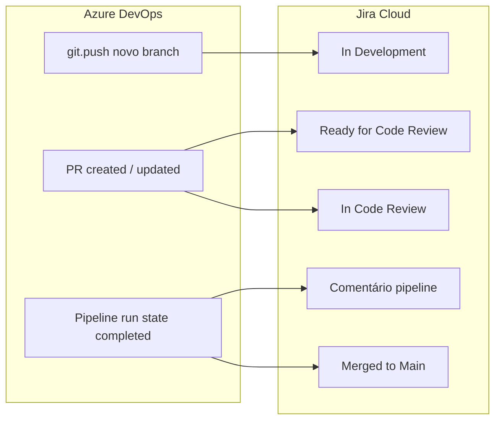
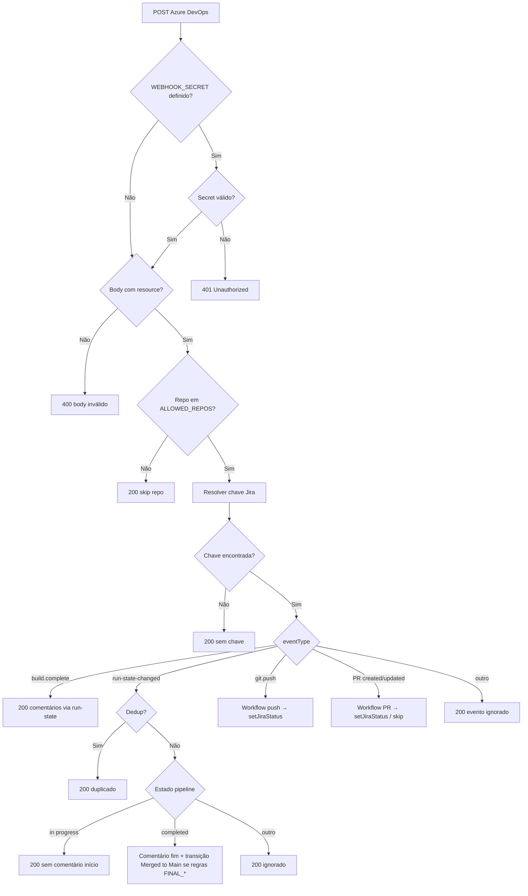

# webhook-function-version-2

Cópia de trabalho para **melhorias** após a apresentação. Código base vindo de `webhook-azure-function-version-1`. `local.settings.json` não foi copiado (use `local.settings.json.example`).

---

## Webhook Azure DevOps → Jira

Uma **Azure Function** que recebe eventos do Azure DevOps (Service Hooks) e atualiza o Jira Cloud automaticamente: **transições de status** conforme o fluxo de trabalho (PR, push, pipeline) e **comentários** nos eventos de pipeline.

## Visão geral

| Origem | O que dispara | Efeito no Jira |
| --- | --- | --- |
| **git.push** | Primeiro push de um branch novo (exceto main/master/develop) | Transição para **In Development** (nome configurável) |
| **git.pullrequest.created** | PR criada | Draft → In Development; ativa → **Ready for Code Review**, **In Code Review** ou conforme revisores/aprovação |
| **git.pullrequest.updated** | PR atualizada | Rework (voto) → In Development (+ limpar campos opcional); aprovação/revisor → In Code Review; etc. |
| **git.pullrequest.merged** | PR mergeada | **Não** aplica *Merged to Main* aqui (só após pipeline na main com sucesso) |
| **ms.vss-pipelines.run-state-changed-event** | Mudança de estado da execução | **Em progresso:** só dedup (sem comentário). **Concluída:** comentário com horários (Brasília) + resultado; se for pipeline “final” na branch certa → **Merged to Main** |
| **build.complete** | Build concluído | **200 ignorado** — comentários vêm pelo *Run state changed* |

**Arquitetura:** TypeScript, handlers em `src/handlers/`, serviços em `src/services/` (`jira`, `workflow`, `pipeline-payload`, `deduplication`, `repository-filter`, `azure-devops`).

---

## Passo a passo — ambiente local

1. **Clonar e instalar**

   ```bash
   git clone <url-do-repositorio>
   cd webhook-function-version-2
   npm install
   ```

2. **Configurar credenciais**

   ```bash
   cp local.settings.json.example local.settings.json
   ```

   Edite `local.settings.json` (veja [Variáveis de ambiente](#variáveis-de-ambiente)).

3. **Subir Storage (Azurite) e a Function** — **dois terminais:**
   - Terminal 1: `npm run start:storage` (deixe rodando).
   - Terminal 2: `npm run start` (build + `func start`).

   Em `local.settings.json`, use `"AzureWebJobsStorage": "UseDevelopmentStorage=true"` com Azurite.

4. **Testar o webhook**

   ```bash
   curl -X POST http://localhost:7071/api/webhook \
     -H "Content-Type: application/json" \
     -d '{"eventType":"git.pullrequest.updated","resource":{"title":"[PROJ-1] Teste","repository":{"name":"meu-repo"},"sourceBranch":"refs/heads/feature/PROJ-1"}}'
   ```

---

## Passo a passo — Azure DevOps (Service Hooks)

Configure as subscrições que correspondem aos eventos que a function trata. **URL:** `https://<seu-function-app>.azurewebsites.net/api/webhook` (ajuste à URL real do app).

| Ordem sugerida | Evento / recurso | Notas |
| --- | --- | --- |
| 1 | **Code pushed** (`git.push`) | Necessário para “novo branch → In Development”. |
| 2 | **Pull request created** | Abertura de PR. |
| 3 | **Pull request updated** | Revisores, votos, draft, etc. |
| 4 | **Run state changed** (Pipelines) | Comentário ao finalizar + transição **Merged to Main** (`JIRA_STATUS_READY_MERGE_MAIN`) quando aplicável. |
| 5 | *(Opcional)* **Pull request merged** | A function hoje **não** mapeia este tipo para transição; pode omitir ou deixar para auditoria. |

Se usar `WEBHOOK_SECRET`, configure o mesmo valor no Service Hook (header `x-webhook-secret` ou query `?secret=...`).

**Filtros:** use `ALLOWED_REPOS` na function para restringir por nome do repositório (lista separada por vírgulas).

---

## Passo a passo — deploy no Azure

1. Ter **Function App** criado e **Application settings** preenchidos (Jira, PAT se necessário, segredo, workflow).
2. Na pasta do projeto: `npm install` e `npm run build`.
3. Publicar: `func azure functionapp publish <nome-app> --resource-group <rg>` **ou** pacote zip com `dist/`, `webhook/`, `host.json`, `package.json` (sem `src/`, sem `local.settings.json`). Ver secção detalhada abaixo se `func publish` falhar.

**Ordem resumida:** app existe → variáveis no Portal → `npm install` → `npm run build` → deploy.

### Deploy com `func azure functionapp publish`

```bash
npm run build
func azure functionapp publish <nome-app> --resource-group <resource-group>
```

### Deploy por zip (quando `func publish` falha)

Inclua no zip: `host.json`, `package.json`, `webhook/`, `dist/`. Exclua segredos e fonte TypeScript.

```bash
npm run build
zip -r deploy.zip . \
  -x "*.git*" \
  -x "local.settings.json" \
  -x "deploy.zip" \
  -x "src/*" \
  -x "*.ts" \
  -x "tsconfig.json" \
  -x ".env*" \
  -x "*.md" \
  -x "node_modules/*"
```

```bash
az functionapp deployment source config-zip \
  --resource-group <resource-group> \
  --name <nome-app> \
  --src deploy.zip
```

### Depois do deploy

- Confirme no Portal: função **webhook** com URL pública.
- Teste: `curl` POST sem `resource` → **400** `Expected JSON body with resource` indica que a function responde.

---

## Fluxo de negócio: Jira vs Azure DevOps

### Nomenclatura recomendada (status no Jira)

Os valores abaixo são os **recomendados** neste projeto e devem coincidir **exatamente** com as transições no Jira (e com `local.settings.json` / Application settings):

| Momento | Nome no Jira | Variável |
| --- | --- | --- |
| Trabalho em feature / rework | **In Development** | `JIRA_STATUS_IN_DEVELOPMENT` |
| PR pronta para revisão | **Ready for Code Review** | `JIRA_STATUS_READY_CODE_REVIEW` |
| Em revisão | **In Code Review** | `JIRA_STATUS_CODE_IN_REVIEW` |
| Pós-merge na main + pipeline final OK | **Merged to Main** | `JIRA_STATUS_READY_MERGE_MAIN` |

O nome da variável `JIRA_STATUS_READY_MERGE_MAIN` é histórico; o **valor** costuma ser **Merged to Main** para refletir que o merge e a pipeline na `main` já ocorreram.

Ordem no workflow:

1. **Novo branch no remoto** (`git.push`) → **In Development**
2. **PR aberta (ativa)** → **Ready for Code Review** (ou **In Code Review** se já houver revisor/aprovação)
3. **Revisor / aprovação** → **In Code Review**
4. **Rework (voto ≤ limite)** → **In Development** + opcional limpeza de campos customizados
5. **Pipeline “final”** na branch principal (ex.: main) com **sucesso** → comentário único no issue + **Merged to Main** (não depende do evento de merge da PR)



---

## Fluxograma — processamento HTTP (function)



---

## Logs — prefixos e o que procurar

Os logs usam prefixos fixos para filtro no **Log stream**, **Application Insights** ou **CLI**.

| Prefixo | Origem | Exemplos de mensagem |
| --- | --- | --- |
| `[webhook]` | Handler HTTP | `POST received`, `Secret validated`, `Payload ok, eventType=`, objeto com `jiraKey`, `Duplicate event`, `Processing run-state-changed`, `PR workflow completed` |
| `[workflow]` | Regras Azure→Jira | `PR decision:`, `git.push decision:`, `pipeline finish` (objeto com branch, pipeline, `shouldReadyMergeMain`) |
| `[jira]` | API Jira | `POST comment for`, `GET transitions failed`, `Transition not found`, `POST transition failed`, `clearIssueFields` |
| `[azure-devops]` | API Azure (commit) | Erros ou sucesso ao ler commit na main para extrair chave |

**Console:** `addJiraComment` também usa `console.info` / `console.warn` com `[jira]` (útil localmente).

### Consultas KQL (Application Insights → Logs)

**Todas as linhas relevantes:**

```kusto
traces
| where message contains "[webhook]" or message contains "[workflow]" or message contains "[jira]" or message contains "[azure-devops]"
| order by timestamp desc
| take 100
```

**Só decisões de workflow:**

```kusto
traces
| where message contains "[workflow]"
| order by timestamp desc
| take 50
```

**Erros ou avisos:**

```kusto
traces
| where severityLevel >= 2 and (message contains "[webhook]" or message contains "[jira]" or message contains "[workflow]")
| order by timestamp desc
| take 50
```

**CLI (stream):** `az webapp log tail --resource-group <rg> --name <nome-app>`

---

## Variáveis de ambiente

Valores aplicam-se a **local.settings.json** (local) e **Configuration → Application settings** (Azure). Não commite segredos.

### Obrigatórias (function + Jira)

| Variável | Descrição |
| --- | --- |
| `AzureWebJobsStorage` | Connection string do Storage. Local com Azurite: `UseDevelopmentStorage=true`. |
| `FUNCTIONS_WORKER_RUNTIME` | Deve ser `node`. |
| `JIRA_BASE_URL` | Ex.: `https://sua-org.atlassian.net` (sem `/` final). |
| `JIRA_USER_EMAIL` | E-mail da conta Atlassian. |
| `JIRA_API_TOKEN` | Token de API Jira. |

### Workflow Jira — nomes de transição

Os nomes devem coincidir com **transição** ou **status de destino** disponíveis no fluxo do projeto Jira (a API lista transições e faz match por nome). Veja a [tabela de nomenclatura recomendada](#nomenclatura-recomendada-status-no-jira).

| Variável | Padrão no código | Exemplo neste projeto |
| --- | --- | --- |
| `JIRA_STATUS_IN_DEVELOPMENT` | `In Development` | `In Development` |
| `JIRA_STATUS_READY_CODE_REVIEW` | `Ready in Code Review` | `Ready for Code Review` (recomendado) |
| `JIRA_STATUS_CODE_IN_REVIEW` | `Code in Review` | `In Code Review` (recomendado) |
| `JIRA_STATUS_READY_MERGE_MAIN` | `Ready to Merge Main` | `Merged to Main` (recomendado) |

**Legado (opcional):** `JIRA_STATUS_CODE_REVIEW` — só é usado como **fallback** se `JIRA_STATUS_READY_CODE_REVIEW` ou `JIRA_STATUS_CODE_IN_REVIEW` estiverem vazios. Podes omitir se preencheres sempre os dois campos específicos (como em `local.settings.json.example`).

### Workflow — revisores e votos (PR)

| Variável | Padrão | Descrição |
| --- | --- | --- |
| `AZURE_DEVOPS_IGNORE_REVIEWER_IDS` | *(vazio)* | IDs ou `uniqueName` de revisores ignorados (ex.: contas de serviço), separados por vírgula. |
| `WORKFLOW_REWORK_VOTE_MAX` | `-5` | Voto ≤ este valor ⇒ rework (→ In Development + limpeza opcional de campos). |
| `WORKFLOW_APPROVE_VOTE_MIN` | `10` | Voto ≥ este valor ⇒ tratado como aprovação humana (Azure DevOps). |
| `JIRA_FIELDS_CLEAR_ON_REWORK` | *(vazio)* | IDs de campos Jira (`customfield_...`) a limpar após rework, separados por vírgula. |

### Pipeline “final” (transição para Merged to Main)

| Variável | Padrão | Descrição |
| --- | --- | --- |
| `FINAL_PIPELINE_BRANCH_REGEX` | Regex default `main` ou `master` (ver código) | Branch da execução deve casar (ex.: `main`). |
| `FINAL_PIPELINE_NAMES` | *(vazio)* | Se preenchido, o **nome** da pipeline deve estar na lista (vírgula, comparação case-insensitive). Vazio = qualquer nome. |
| `FINAL_PIPELINE_TRANSITION_ENABLED` | `true` | `0` ou `false` desliga a transição para `JIRA_STATUS_READY_MERGE_MAIN` (mantém só comentário). |
| `FINAL_PIPELINE_ALLOW_EMPTY_BRANCH` | `false` | Se `true` e `FINAL_PIPELINE_NAMES` definido, permite transição mesmo sem branch no payload quando o nome da pipeline bate. |

### Azure DevOps (chave Jira no commit)

| Variável | Obrigatória | Descrição |
| --- | --- | --- |
| `AZURE_DEVOPS_PAT` | Não | PAT para ler commit quando a pipeline roda na **main/master** e a chave não veio do título/branch/payload. |

### Segurança, filtro e deduplicação

| Variável | Padrão | Descrição |
| --- | --- | --- |
| `WEBHOOK_SECRET` | *(vazio)* | Se definido, exige header `x-webhook-secret` ou query `?secret=` igual. |
| `ALLOWED_REPOS` | *(vazio)* | Nomes de repositório permitidos (vírgula). Vazio = todos. |
| `WEBHOOK_DEDUP_TTL_MS` | `3600000` | TTL do cache in-memory de deduplicação (pipelines). |

### Outros

| Variável | Descrição |
| --- | --- |
| `PIPELINE_COMMENT_MODE` | **Não** referenciado pelo código atual (opcional; ignorado). |
| `EVENT_STORE_DISABLED` | Se existir no ficheiro local, **não** é referenciado pelo código TypeScript atual (pode ignorar). |

---

## Testes (Jest)

| Comando | Descrição |
| --- | --- |
| `npm test` | Todos os testes. |
| `npm run test:watch` | Watch. |
| `npm run test:coverage` | Cobertura em `coverage/`. |

Inclui `webhook.handler`, `jira`, `pipeline-payload`, `deduplication`, `repository-filter`, `workflow`, `azure-devops`.

---

## Testes rápidos com curl

**Body inválido (400):**

```bash
curl -X POST http://localhost:7071/api/webhook -H "Content-Type: application/json" -d '{}'
```

**PR updated (transição conforme workflow):**

```bash
curl -X POST http://localhost:7071/api/webhook \
  -H "Content-Type: application/json" \
  -d '{"eventType":"git.pullrequest.updated","resource":{"title":"[PROJ-1] Tarefa","repository":{"name":"meu-repo"},"sourceBranch":"refs/heads/feature/PROJ-1"}}'
```

**Pipeline concluída (comentário + possível transição Merged to Main):**

```bash
curl -X POST http://localhost:7071/api/webhook \
  -H "Content-Type: application/json" \
  -d '{"eventType":"ms.vss-pipelines.run-state-changed-event","resource":{"state":"Completed","result":"Succeeded","title":"Build PROJ-1","repository":{"name":"meu-repo"},"sourceBranch":"refs/heads/main","_links":{"web":{"href":"https://dev.azure.com/org/project/_build/results?buildId=1"}}}}'
```

---

## Solução de problemas (resumo)

| Sintoma | O que verificar |
| --- | --- |
| Porta 7071 ocupada | `lsof -i :7071` ou `func start --port 7072`. |
| Host não inicia localmente | Azurite + `UseDevelopmentStorage=true`. |
| 401 | `WEBHOOK_SECRET` e header/query. |
| 200 sem mudar Jira | Chave no título/branch; `ALLOWED_REPOS`; logs `[webhook]` com `jiraKey`. |
| Transição falha | Logs `[jira] Transition not found` — nome exato da transição no Jira. |
| `func publish` falha | Deploy por zip (secção acima). |

---

## Estrutura de diretórios (principal)

Cada pasta em `src/services/<nome>/` contém o módulo `<nome>.ts` e o teste `<nome>.test.ts` (sem `index.ts`). Tipos partilhados estão em `src/types.ts`.

**`src/webhook/` vs `src/services/workflow/`:** são coisas diferentes. **`src/webhook/`** só tem o `function.json` (binding HTTP da Azure Function). **`src/services/workflow/`** é a lógica Azure DevOps → Jira (transições, PR, pipeline). Não há duplicado a remover.

```text
webhook-function-version-2/
├── host.json
├── package.json
├── local.settings.json.example
├── src/
│   ├── types.ts
│   ├── webhook/function.json
│   ├── handlers/webhook.handler.ts
│   ├── services/jira/jira.ts
│   ├── services/workflow/workflow.ts
│   ├── services/pipeline-payload/pipeline-payload.ts
│   ├── services/deduplication/deduplication.ts
│   ├── services/repository-filter/repository-filter.ts
│   └── services/azure-devops/azure-devops.ts
├── dist/          # build
└── webhook/       # function.json copiado no build
```

---

## Contribuição

Fork, branch de feature e Pull Request com descrição clara das mudanças.

## Referências

- [Azure Functions](https://learn.microsoft.com/azure/azure-functions/functions-overview)
- [Azure Functions Core Tools](https://learn.microsoft.com/azure/azure-functions/functions-run-local)
- [Service Hooks – Web Hooks](https://learn.microsoft.com/azure/devops/service-hooks/services/webhooks)
- [Jira Cloud REST API](https://developer.atlassian.com/cloud/jira/platform/rest/v3/intro/)
- [API tokens Atlassian](https://id.atlassian.com/manage-profile/security/api-tokens)

## Licença

Uso interno conforme a política da sua organização.
